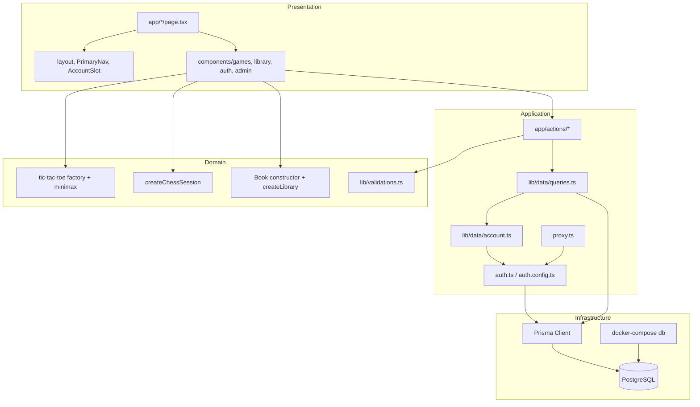
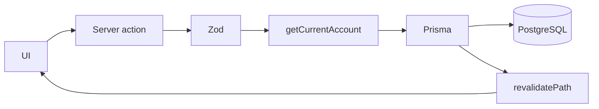

# Architecture

BGames is a Next.js App Router application. Server Components read the session and the database. Client Components run the boards, the library desk, and the forms.

Runtime walkthroughs live in [HOW_IT_WORKS.md](HOW_IT_WORKS.md).

---

## Layer diagram

---

## Brand and UI

Design tokens live in `app/globals.css` as custom properties: obsidian canvas, graphite surfaces, a 4px radius, electric violet for primary actions and selection, and ice blue for indexes and the O mark. Space Grotesk is the display face, Geist is the body, and JetBrains Mono is used for indexes and statistics.

The live interface mark is `public/brandi.png`, rendered by `components/brand/logo.tsx`. Favicons are PNG/ICO derived from that lockup (`app/favicon.ico`, `app/icon.png`, `public/favicon-32.png`). Geometric SVG drafts remain under `public/brand/` but are not what the header shows.

Navigation is a numbered index. Account state streams in behind a Suspense boundary so the shell can prerender while the session is read.

Boards use CSS Grid with `aspect-ratio: 1` and `minmax(0, 1fr)` tracks. Pieces are positioned inside the square so an SVG cannot stretch a row.

---

## Games

Tic tac toe rules, the match factory, and the minimax module do not import React.

- `lib/games/tic-tac-toe/rules.ts` detects wins and draws
- `lib/games/tic-tac-toe/factory.ts` hides the board in a closure (`createTicTacToeGame`)
- `lib/games/tic-tac-toe/ai.ts` is an IIFE module. Hard mode is minimax. Easy mode picks a random empty square through an injected random function so tests stay deterministic

Chess rules are not reimplemented. `lib/games/chess/session.ts` is a factory around chess.js. The UI in `components/games/chess-game.tsx` renders that session. There is no chess engine and no online opponent. A random mover is intentionally absent so the product does not pretend to have a rated computer.

---

## Library

`lib/library/book.js` is plain JavaScript. Books are constructed with `new Book`, and `info`, `toggleRead`, and `update` live on `Book.prototype`. `lib/library/collection.js` closes over the array, which is the Odin `myLibrary` idea in a form that can be created per shelf.

Guests persist plain snapshots in `localStorage`. Signed-in readers send the same fields through server actions. The server validates with Zod and writes Prisma rows that the user owns. The client revives server rows with `new Book` before rendering `book.info()`.

---

## Accounts

Auth.js uses the credentials provider. Passwords are hashed with bcrypt and never returned to the client. Sessions are JWTs, so the Account and Session tables exist for the Auth.js schema but are not written by this credentials flow.

`proxy.ts` redirects anonymous visitors away from `/dashboard`, `/profile`, and `/admin`, and sends non-administrators away from `/admin`. That is a convenience check on the JWT. `getCurrentAccount()` loads the user from PostgreSQL. `setUserRole` requires `ADMIN` and refuses self-changes and demoting the last administrator. `adminSnapshot` / `searchUsers` are only called after `AdminBody` confirms `role === ADMIN`; those two query functions do not contain a second internal role guard. Hiding a link is not the authorization.

The administrator is created only by `prisma/seed.ts` from `ADMIN_EMAIL` and `ADMIN_PASSWORD`. Those values are not hardcoded. Signing up never sets `ADMIN`.

---

## Data

`prisma/schema.prisma` defines users, books, and game matches, plus the Auth.js account, session, and verification models. Match rows store the game, the result from the signed-in player's point of view, an opponent label, and a move count.

Schema is applied with `prisma db push`. This repository does not ship a `prisma/migrations` history.

Results are submitted by the browser after a local game ends. The server checks the shape of that payload and the session. It does not replay the game. That is an accepted limit of local play: a modified client could post a false result. Players can only write their own books and matches.

Dashboard and admin numbers are counts and recent rows from PostgreSQL. If there are no matches, the UI says so. If PostgreSQL is down, dashboard and admin show an offline message; games still run locally.

`getPrisma()` in `lib/db.ts` is a process singleton.

---

## Rendering

`cacheComponents` is enabled. Session and database reads sit inside Suspense so they are not part of the static shell. Public pages (home, games, about, sign-up) can prerender their copy. Interactive boards that read `localStorage` are client-only so a guest record does not hydrate as an empty shelf and then jump.

The only HTTP API route is `app/api/auth/[...nextauth]/route.ts`. Domain mutations are `"use server"` functions, not REST resources.

---

## Docker

`docker-compose.yml` runs `postgres:16`, publishes **5434:5432**, and stores files in volume `bgames-data`. There is no application Dockerfile. The Node process runs on the host.

---

## Tests

`tests/games.test.ts` covers win and draw detection, illegal moves, minimax tactics, a perfect-play draw, chess legality, scholar's mate, stalemate, promotion, castling, en passant, and the book constructor.
