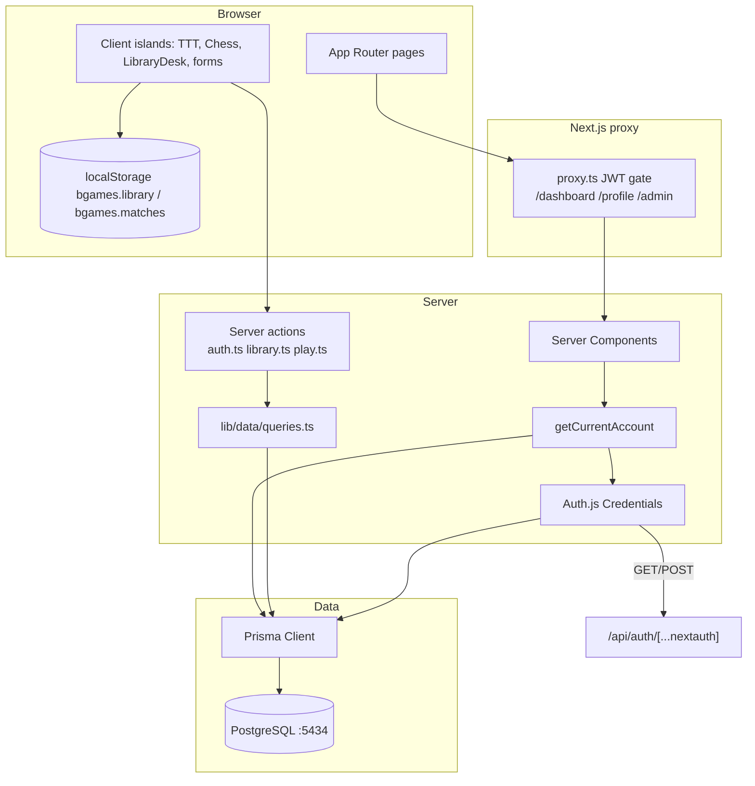

# BGames — Project Audit

Read-only audit of `C:\Users\gasim\OneDrive\Desktop\BGames` on 20 October 2026. Application source was not modified. Secrets from `.env` are not reproduced.

---

## 1. Actual technology stack

| Layer | Technology | Evidence |
| --- | --- | --- |
| Runtime UI | Next.js **16.4.2** App Router, React **19.3.0** | `package.json` |
| Language | TypeScript 5 (strict); library domain in JS | `tsconfig.json`, `lib/library/book.js` |
| Styling | Tailwind CSS v4 + project tokens | `app/globals.css` `@import "tailwindcss"` |
| Auth | Auth.js `next-auth@5.0.0-beta.32`, Credentials, **JWT** | `auth.ts`, `auth.config.ts` |
| Passwords | bcryptjs cost 12 | `registerAccount`, `prisma/seed.ts` |
| Validation | Zod 4 + React Hook Form | `lib/validations.ts`, `components/auth/auth-forms.tsx` |
| Database | PostgreSQL via Prisma **6.19.3** | `prisma/schema.prisma`, `docker-compose.yml` |
| Chess rules | **chess.js 1.4.0** (not a custom engine) | `lib/games/chess/session.ts` |
| Charts / icons / motion | Recharts, lucide-react, Motion (route fade only) | `result-chart.tsx`, `auth-forms.tsx`, `app/template.tsx` |
| Tests | Vitest 4, Node environment | `vitest.config.ts`, `tests/games.test.ts` |
| Containers | Compose **Postgres only**; **no app Dockerfile** | `docker-compose.yml`; glob found 0 Dockerfiles |

**Not in the stack:** Express, Socket.IO, Redux, Prisma adapter sessions, OAuth, a chess engine, Redis, Kubernetes, an application container.

---

## 2. Architecture diagram



**Request path (signed-in book create):**  
UI `LibraryDesk` → `createShelfBook` (`app/actions/library.ts`) → `saveBook` → `getCurrentAccount` (`auth()` + `user.findUnique`) → `bookSchema` → `book.create` → `revalidatePath`.

**Guest path:** same UI → `createLibrary().add` → `localStorage`. No server.

---

## 3. Routes and major files

| Route | File | Server / client |
| --- | --- | --- |
| `/` | `app/page.tsx` | Server + chess preview island |
| `/games` | `app/games/page.tsx` | Server |
| `/games/tic-tac-toe` | `app/games/tic-tac-toe/page.tsx` | Server loader + client island |
| `/games/chess` | `app/games/chess/page.tsx` | Server loader + client island |
| `/library` | `app/library/page.tsx` | Server loader + client island |
| `/sign-in` `/sign-up` | `app/sign-in/page.tsx`, `app/sign-up/page.tsx` | Server + client forms |
| `/dashboard` `/profile` `/admin` | matching `page.tsx` | Server; profile name form is client |
| `/about` | `app/about/page.tsx` | Server |
| `/api/auth/[...nextauth]` | `route.ts` | Auth.js handlers only |

---

## 4. Feature verification matrix

Legend: **Pass (test)** = Vitest this session. **Pass (browser)** = exercised in the Cursor browser this session. **Pass (code)** = implementation present; not re-executed this session. **Partial** = works with caveats. **Fail / missing** = not implemented or not available during this run.

| Feature | Status | Notes |
| --- | --- | --- |
| Homepage / catalog | Pass (browser) | `http://localhost:3000/` rendered; session showed an Administrator chip |
| Tic-tac-toe init, turns, invalid moves | Pass (test) | `factory` tests |
| Tic-tac-toe win/draw detection | Pass (test) | `findWinner`, `isDraw` |
| Tic-tac-toe minimax win/block/draw | Pass (test) | `ai.ts` |
| Tic-tac-toe vs hard AI in UI | Pass (browser) | X on a1-equivalent; O took centre; “X to move.” |
| Tic-tac-toe human vs human | Pass (code) | Mode `"human"`; not clicked this session |
| Tic-tac-toe restart | Pass (code) | New `createTicTacToeGame("X")` |
| Chess legal/illegal | Pass (test) | `e2e4` accepted; `e2e5` null |
| Chess checkmate / stalemate | Pass (test) | Scholar’s mate; stalemate FEN |
| Chess castle / en passant / promotion | Pass (test) | Not all three clicked in the UI this session |
| Chess UI one move | Pass (browser) | `e2-e4` → “Black to move.” |
| Chess AI / online | Missing | Intentionally absent |
| Library add/edit/delete/read | Pass (browser, device path) | Added “Audit Fixture Book”, `info()` sentence, removed via Confirm remove |
| Library Postgres CRUD | Pass (code) | Not live: DB unreachable this session |
| Guest `localStorage` | Pass (browser) | Banner: database offline, shelf on this device |
| Sign-in form present | Pass (browser) | Email, password, show-password |
| Credentials bcrypt login | Pass (code) | `auth.ts` `authorize`; login with a wrong password **not** submitted this session (tool block) |
| Signup never ADMIN | Pass (code) | `registerAccount` create data has no `role` |
| Dashboard with DB | Partial | Browser: “Record unavailable” — Postgres down |
| Admin with DB | Partial | Browser: “The board is offline.” |
| Admin role confirm UI | Pass (code) | `RoleControl`; not clicked this session |
| Proxy anonymous redirect | Pass (code) | Session already authenticated; redirect not re-tested |
| Docker Postgres running | Fail (this machine) | Docker Desktop engine not running (`npipe` missing) |
| App container | Missing | No Dockerfile |
| Unit tests | Pass | 14/14 |
| Typecheck | Pass | `tsc --noEmit` exit 0 |
| Lint | Pass with warnings | 0 errors, 4 `@next/next/no-img-element` |
| Production build this session | Not run | Avoided `prisma generate` while `next dev` holds the query engine |

---

## 5. Working features (code + tests, and/or this session’s browser)

- Tic-tac-toe factory, rules, easy/hard AI, keyboard grid, mute, match recording hooks.
- Chess session over chess.js: legal moves, check/mate/draw flags, undo, resign, flip, FEN query, SAN history, SVG pieces.
- Library constructor/collection, filters, guest persistence, signed-in Prisma path (when DB is up).
- Auth.js credentials, Zod, hashed passwords, JWT, proxy gates, `setUserRole` rules.
- Dashboard/admin queries and Recharts **when PostgreSQL answers**.
- Semantic shell, CSS Grid boards, tokenized dark UI.

---

## 6. Partially working / environment-dependent

- **Signed-in persistence** requires Docker Postgres on host port **5434**. This audit session: Docker engine stopped; library fell back to device storage; dashboard and admin showed offline copy; JWT cookie still identified an Administrator in the header.
- **ARCHITECTURE.md / README** say admin queries refuse unless ADMIN. **Page** `AdminBody` refuses; functions `adminSnapshot` and `searchUsers` do not check role internally.
- **Brand docs** still mention SVG `app/icon.svg` and SVG `BrandMark`. Live UI uses `/brandi.png`; `app/icon.png` and `app/apple-icon.png` exist.
- **JWT `role` vs database `role`:** proxy uses the token; pages use Prisma. Demotion may leave `/admin` reachable at the proxy until re-login; the page would still refuse.

---

## 7. Missing features (do not claim these)

- Chess engine / computer opponent / clocks / online play / PGN export UI.
- OAuth, magic link, email verification, password reset (`VerificationToken` unused).
- REST resource APIs for books or matches.
- Prisma Migrate history (`prisma/migrations/` absent).
- Next.js app Docker image / Compose app service.
- Merge of guest `localStorage` into an account on sign-in.
- Rate limiting, CSP, account lockout.
- Dedicated CSS `@supports` / prefix browser-compatibility lesson.
- Invented developer biography (`content/developer.ts` is a placeholder).

---

## 8. Bugs, limitations, security

| Severity | Item |
| --- | --- |
| High (integrity) | `recordMatch` trusts client `{ game, result, opponent, moves }`. A modified client can post a fake win. Documented in `ARCHITECTURE.md`. |
| Medium | `adminSnapshot` / `searchUsers` have no ADMIN assertion inside the query module. |
| Medium | JWT role staleness for `proxy.ts`. |
| Medium | Compose default DB password `bgames` is for local use only. |
| Low | No CSP / security headers in `next.config.ts`. |
| Low | ESLint `no-img-element` on brand `` tags. |
| Product | No password reset; last-admin protection exists only in `setUserRole`. |
| Ops | `db push` instead of versioned migrations. |
| Ops | App not containerized; demo fails if Docker Desktop is off. |

---

## 9. Odin mapping (audit verdict)

| Topic | Verdict | Where |
| --- | --- | --- |
| Semantic HTML | Present | `layout.tsx`, pages, tables, forms |
| SVG | Present for pieces/marks; brand UI is PNG | `chess-piece.tsx`, TTT glyphs |
| Tables | Present | dashboard, admin |
| CSS units / functions / custom properties | Present | `globals.css` |
| Advanced selectors / positioning | Present | `:focus-visible`, sticky header, absolute pieces |
| Responsive | Present | `@media (max-width: 860px)` |
| Forms + validation | Present | HTML + Zod + RHF |
| CSS Grid / Flexbox | Present | boards, shell |
| Browser compatibility curriculum | **Missing / weak** | `prefers-reduced-motion` only |
| Objects / constructor / factory / module / encapsulation | Present | book.js, factories, IIFE AI |
| State | Present (closures + React) | not vanilla globals |
| DOM APIs | **Adapted** | no `document.querySelector` in app source |
| Events | Present | React handlers, arrow keys on boards |
| Library project / TTT project | Present | as specified |

---

## 10. Commands run this session

```
npm test          → 14 passed (1 file), exit 0
npm run typecheck → tsc --noEmit, exit 0
npm run lint      → 4 warnings, 0 errors, exit 0
docker compose ps → failed: Docker Desktop Linux engine pipe missing
npm run build     → not executed (dev server already running)
```

**Browser (Cursor browser, existing Administrator JWT, Postgres down):**

- `/` homepage
- `/games/tic-tac-toe` — hard AI answered a corner with centre
- `/games/chess` — e2–e4, status Black to move
- `/library` — device fallback; add + confirm-remove
- `/dashboard` — “Record unavailable.”
- `/admin` — “The board is offline.”
- `/sign-in` — form visible (wrong-password submit not completed)

Do not treat historical chats as this session’s runtime proof.

---

## 11. Deployment readiness

**Local coursework demo:** ready if Node, `.env`, and `docker compose up -d` are running, schema pushed, and admin seeded from env.

**Production:** not ready as a hardened service. Missing app container, migrations, secrets management beyond a gitignored `.env`, HTTPS/session hardening notes, match integrity, CSP, and rate limits. `AUTH_SECRET` must not remain the example placeholder.

---

## 12. Recommended fixes (priority)

1. **Integrity:** document match trust in the viva (already honest) or add server-side replay later.  
2. **Authz:** `if ((await getCurrentAccount())?.role !== "ADMIN") throw` at the top of `adminSnapshot` and `searchUsers`.  
3. **Ops:** Prisma migrate; optional `Dockerfile` for `next start`.  
4. **Session:** refresh JWT role from DB in the `jwt` callback on each request, or shorten session.  
5. **Headers:** CSP / `no-img-element` via `next/image` if you want a clean lint.  
6. **Product:** password reset, guest merge, chess clocks — only if the brief expands.

---

## 13. Documentation drift

- `ARCHITECTURE.md` brand section: SVG icons vs PNG in the running app.  
- `ACADEMIC_MAPPING.md` SVG row lists `logo.tsx` / `app/icon.svg` as SVG; logo is an ``.  
- Admin query “refuse on the server” is true for **actions** (`setUserRole`) and the **page**, not for the snapshot functions themselves.
