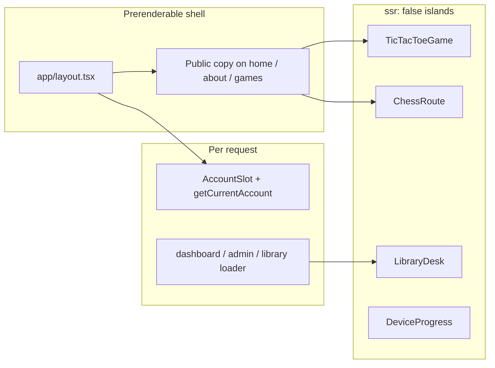
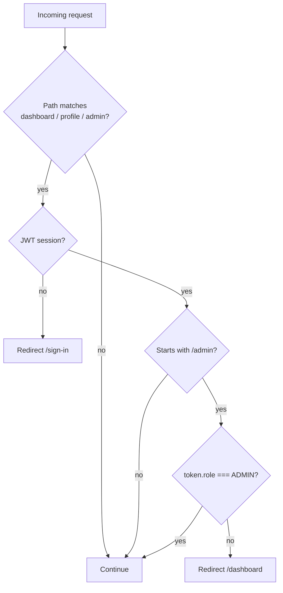
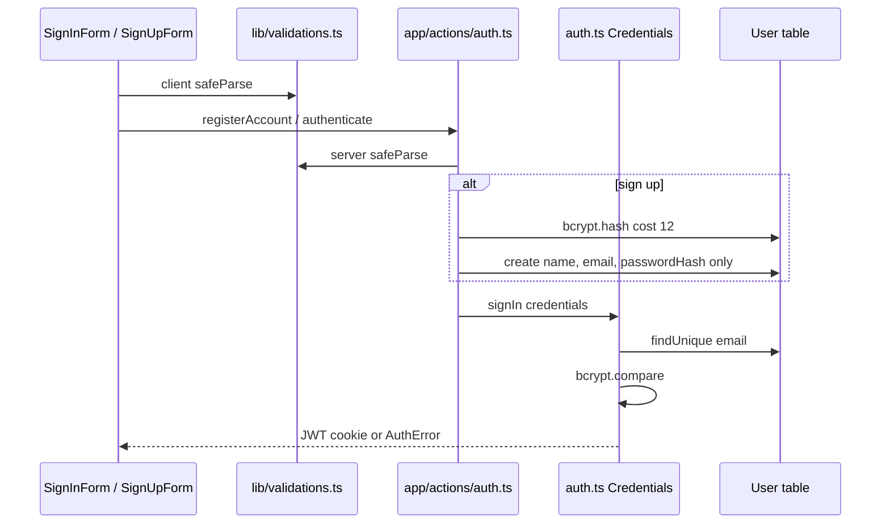
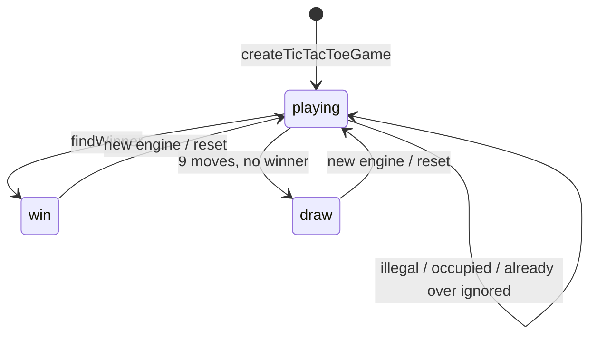
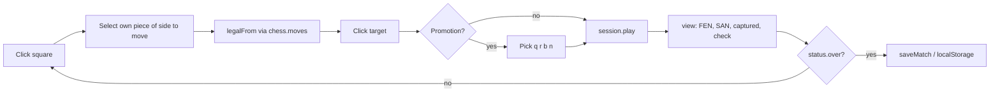
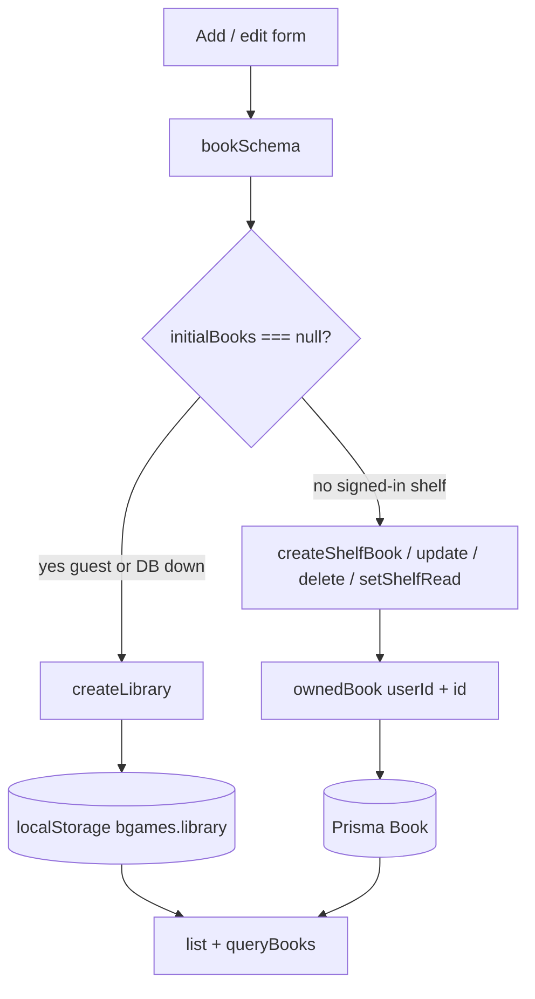
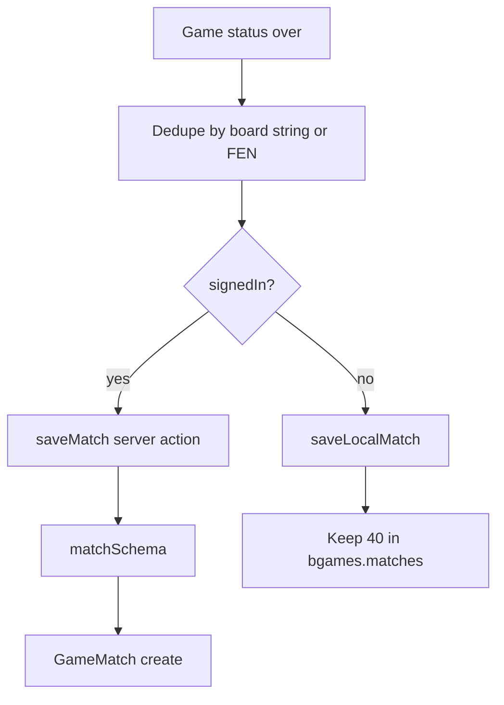
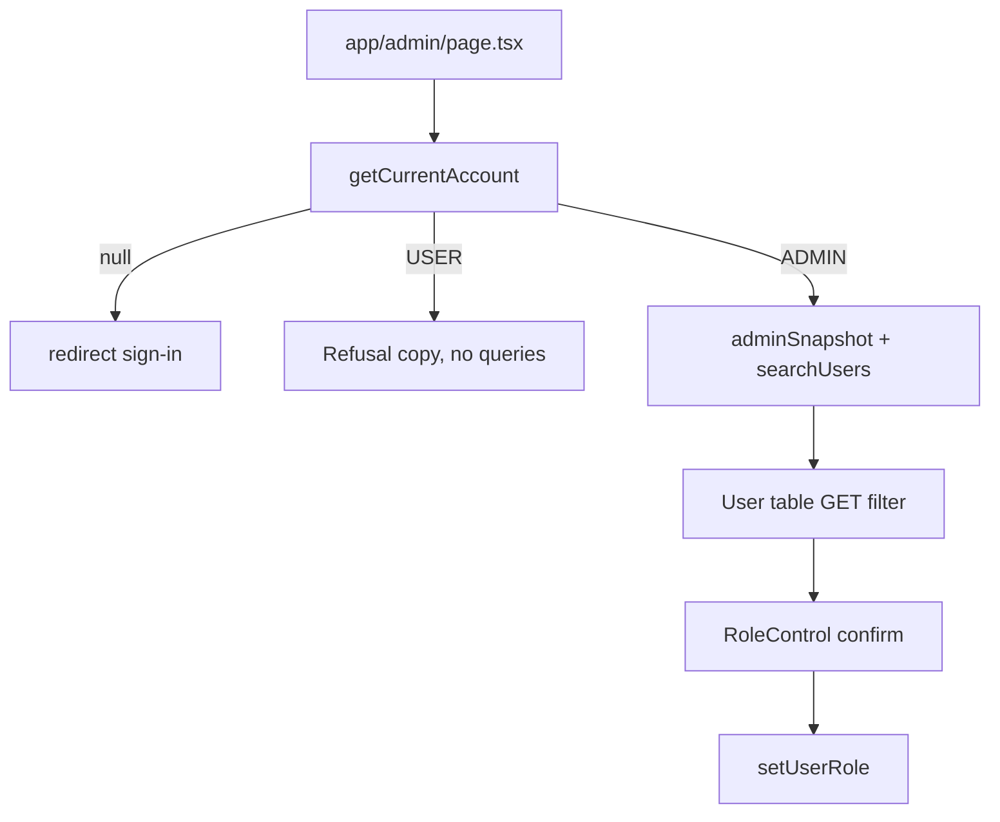
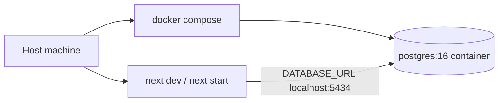

# How BGames works

This document is a walkthrough of runtime behaviour: who executes what, where state lives, and how data returns to the UI. File paths are the source of truth.

Related: [ARCHITECTURE.md](ARCHITECTURE.md) · [README.md](README.md)

---

## 1. Rendering model

- **Server Components** read the session and PostgreSQL. They sit behind `Suspense` so `cacheComponents` can still prerender the chrome.
- **`getCurrentAccount()`** (`lib/data/account.ts`) calls `await connection()` before `auth()`, then loads the user row. The database role is the source of truth for pages.
- **Client islands** (`components/islands.tsx`) use `next/dynamic` with `{ ssr: false }` so `localStorage` does not hydrate as an empty shelf and then jump.
- **`app/template.tsx`** fades route changes unless `prefers-reduced-motion`.

`export const instant = false` on the root layout disables instant navigation for this app.

---

## 2. Route protection

Implemented in `proxy.ts` (Next.js 16 Proxy, not `middleware.ts`).

The page still calls `getCurrentAccount()`. A player who reaches `/admin` with a stale JWT sees “Administrator access required,” not the table. `setUserRole` checks `ADMIN` again.

---

## 3. Authentication

| Step | Function | Behaviour |
| --- | --- | --- |
| Register | `registerAccount` | No `role` in `create` data → schema default `USER` |
| Sign in | `authorize` | Invalid parse or bad password → `null` |
| Sign out | `signOutAction` | Redirect `/` |
| Profile | `updateProfile` | Requires session; `profileSchema` |
| Admin | `setUserRole` | Refuses non-admin, self, last admin |

Admin bootstrap is `prisma/seed.ts` from `ADMIN_EMAIL` / `ADMIN_PASSWORD`. Those values are not hardcoded.

Open redirect guard: `callbackUrl` must start with `/` and must not start with `//`.

---

## 4. Tic tac toe

| Layer | File | Responsibility |
| --- | --- | --- |
| Rules | `lib/games/tic-tac-toe/rules.ts` | `WIN_LINES`, `findWinner`, `isDraw` |
| State | `lib/games/tic-tac-toe/factory.ts` | Closure: `snapshot`, `play`, `reset` |
| AI | `lib/games/tic-tac-toe/ai.ts` | IIFE; `chooseMove` only public API |
| UI | `components/games/tic-tac-toe-game.tsx` | Renders snapshot; does not decide legality |

**Hard AI:** minimax, no depth cap. Win `10 - depth`, loss `depth - 10`, draw `0`. Two hard players draw from the opening (Vitest).

**Easy AI:** random empty square; `random` is injectable for tests.

**Computer turn:** `useEffect` when `snapshot.current === computerMark`, ~180ms delay, then `chooseMove`.

There is **no** networked multiplayer. “Another person” is pass-and-play on one screen.

---

## 5. Chess

`lib/games/chess/session.ts` wraps `new Chess()` from **chess.js**.

BGames does **not** implement move generation. chess.js owns legality, check, checkmate, stalemate, threefold, insufficient material, fifty-move, castling, en passant, and promotion.

Custom code: `describePosition` (labels), `resign`, captured lists, React board, SVG pieces in `components/games/chess-piece.tsx`.

Optional `?fen=` loads a position; invalid FEN falls back to the start with a notice.

---

## 6. Library CRUD

- `lib/library/book.js` — `new Book`; prototype `info`, `toggleRead`, `update`.
- `lib/library/collection.js` — `createLibrary` closes over the array (`myLibrary`).
- Guest persistence is the desk. The collection module itself is storage-agnostic and unit-tested.
- Signed-in rows are always scoped by `userId`. There is **no** merge from guest storage into an account on login.

If PostgreSQL is down, the library page loads the device shelf and says so.

---

## 7. Match recording

Perspective:

- Tic tac toe: WIN if `winner === humanMark`.
- Chess: WIN/LOSS from the colour chosen in “Record the result for.”

The server does **not** replay moves. That is an accepted limit of local play.

---

## 8. Admin console

Counts come from the database. Hiding the Admin nav link is not authorization.

---

## 9. Docker vs the Node process

| Piece | In this repo? |
| --- | --- |
| Postgres image + volume `bgames-data` | Yes |
| Next.js `Dockerfile` | No |
| Compose service for the app | No |

A **Docker image** is the packaged filesystem. A **container** is a running instance. Only the database is defined as an image here.
