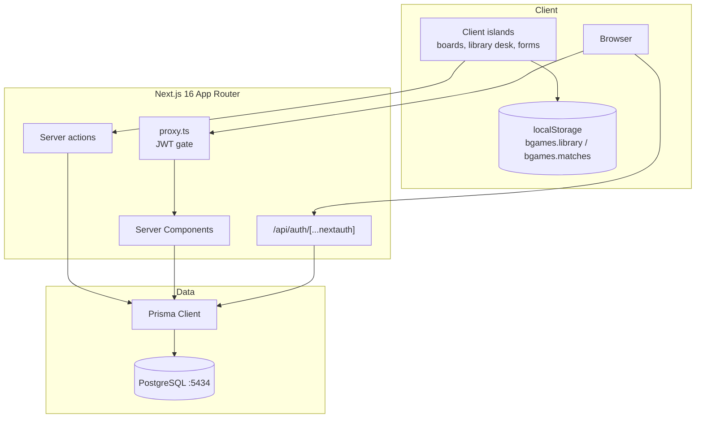
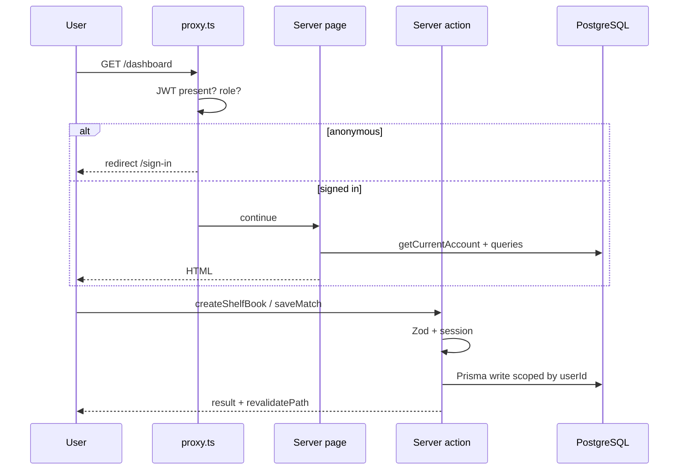
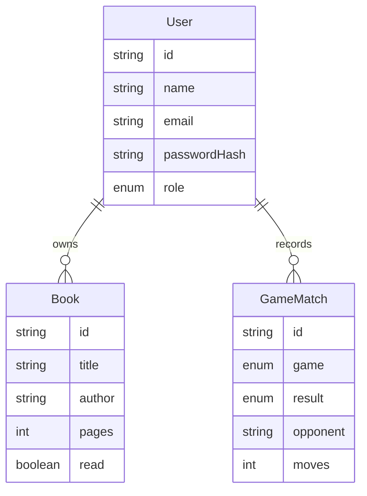

# BGames

A dark-first web platform for **chess**, **tic tac toe**, and a **personal library**, with real accounts, PostgreSQL persistence, and an administrator console.

BGames is a university full-stack project aligned with [The Odin Project](https://www.theodinproject.com/) (sign-up form, library, tic tac toe, admin dashboard), extended with a legal local chess board and match history. The games run. Empty dashboards stay empty until someone plays.

**Live local URL:** [http://localhost:3000](http://localhost:3000)

| Docs | What it covers |
| --- | --- |
| [HOW_IT_WORKS.md](HOW_IT_WORKS.md) | Request lifecycle, guest vs account, game and CRUD flows |
| [ARCHITECTURE.md](ARCHITECTURE.md) | Layers, rendering, auth, data, security limits |
| [ACADEMIC_MAPPING.md](ACADEMIC_MAPPING.md) | Odin objectives mapped to files |
| [BGAMES_PROJECT_AUDIT.md](BGAMES_PROJECT_AUDIT.md) | Verification matrix and limitations |
| [BGAMES_TECHNICAL_PRESENTATION_SCRIPT.md](BGAMES_TECHNICAL_PRESENTATION_SCRIPT.md) | Spoken viva script |
| [BGAMES_SCREEN_RECORDING_GUIDE.md](BGAMES_SCREEN_RECORDING_GUIDE.md) | Screen-recording walkthrough |
| [BGAMES_TECHNICAL_QA.md](BGAMES_TECHNICAL_QA.md) | Lecturer Q&A |

---

## System overview



Guests play and keep a shelf **in this browser**. Signed-in users write **their own** matches and books to PostgreSQL. Signup never creates an administrator.

---

## Stack

| Concern | Choice | Why it is here |
| --- | --- | --- |
| UI / routing | Next.js 16 App Router, React 19, TypeScript | Server Components for session/DB; client islands for boards |
| Styling | Tailwind v4 + tokens in `app/globals.css` | Dark canvas, 4px radius, violet only for actions |
| Auth | Auth.js Credentials, JWT, bcryptjs | Real password hashes, not a mock `isLoggedIn` |
| Validation | Zod (+ React Hook Form on auth) | Same schemas in the browser and on the server |
| Database | PostgreSQL + Prisma 6 | `User`, `Book`, `GameMatch` |
| Chess rules | chess.js | Legal moves; **not** a custom engine |
| Tic tac toe AI | Custom minimax in `lib/games/tic-tac-toe/ai.ts` | Hard = full tree; easy = random empty square |
| Library domain | Plain JS constructor `new Book` | Odin Library project, kept outside React |
| Tests | Vitest | Rules, minimax, chess legality, book constructor |
| Local DB | Docker Compose `postgres:16` on host **5434** | The Next.js app itself is **not** containerized |

---

## Features

- **Tic tac toe** — pass-and-play or computer. Easy picks a random legal square. Hard is minimax (takes a win, blocks a loss, draws perfect play).
- **Chess** — local two-player board. Check, checkmate, stalemate, draws, castling, en passant, promotion, undo, flip, resign. No engine. No online play.
- **Library** — add, edit, delete, toggle read, search, filter, sort. Constructor + collection factory in `lib/library/`.
- **Accounts** — sign-up / sign-in, hashed passwords, player dashboard, profile name, admin console (seeded role only).
- **Stats** — Recharts on real win / loss / draw counts. New accounts show an empty record.

---

## How a request moves



Detail for every product surface: [HOW_IT_WORKS.md](HOW_IT_WORKS.md).

---

## Repository layout

```
app/            Routes, layouts, server actions, Auth.js route
components/     Shell, games, library desk, auth forms, admin
lib/            Game rules, Book constructor, Prisma queries, Zod
prisma/         schema.prisma + seed (admin from env)
proxy.ts        Next.js 16 auth gate (replaces middleware.ts)
auth.ts         Credentials provider + bcrypt
docker-compose.yml   Postgres only
tests/          Vitest
content/        Public developer placeholder (no invented bio)
```

---

## Setup

1. `npm install`
2. Copy `.env.example` to `.env`. Set `AUTH_SECRET` (`npx auth secret`).
3. Start Postgres: `docker compose up -d` (host port **5434**).
4. `npm run db:push`
5. Optional admin: set `ADMIN_EMAIL` and `ADMIN_PASSWORD` in `.env`, then `npm run db:seed`. Do not commit those values.
6. `npm run dev` → [http://localhost:3000](http://localhost:3000)

Guest games and the guest library work without the database. Sign-in, dashboard, saved shelves, and admin need PostgreSQL.

### Scripts

| Command | Purpose |
| --- | --- |
| `npm run dev` | Development server |
| `npm run build` | `prisma generate` then `next build` |
| `npm start` | Production server |
| `npm test` | Vitest |
| `npm run typecheck` | `tsc --noEmit` |
| `npm run lint` | ESLint |
| `npm run db:push` | Apply Prisma schema |
| `npm run db:seed` | Create or promote administrator from env |

---

## Data model



`Account` / `Session` / `VerificationToken` exist for an Auth.js adapter. This credentials app uses **JWT** and does not write those tables.

---

## Security notes (honest)

- Passwords are bcrypt hashes. Signup cannot grant `ADMIN`.
- `proxy.ts` plus `getCurrentAccount()` protect private routes. Role changes cannot target self or demote the last admin.
- Match results are submitted by the client after local play. The server stores a validated payload; it does **not** replay the game.
- Docker Compose ships a local Postgres password for development only.
- `.env` is gitignored. Use `.env.example` as the template.

---

## Deployment

Structured for a Node host or Vercel plus a hosted Postgres (Neon, Vercel Postgres, and similar).

1. Provision PostgreSQL and set `DATABASE_URL` and `AUTH_SECRET`.
2. `npx prisma db push`, then seed an admin if needed.
3. `npm run build` (generates the Prisma client, then Next.js).

There is **no** application `Dockerfile`. Compose containerizes the database only.

---

## Academic and presentation

Set your name and links in `content/developer.ts` before a presentation. The about page does not invent a biography.

See [ACADEMIC_MAPPING.md](ACADEMIC_MAPPING.md) for which Odin files this repo actually implements.
